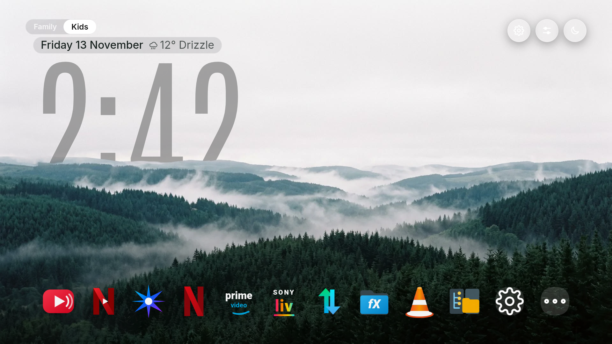
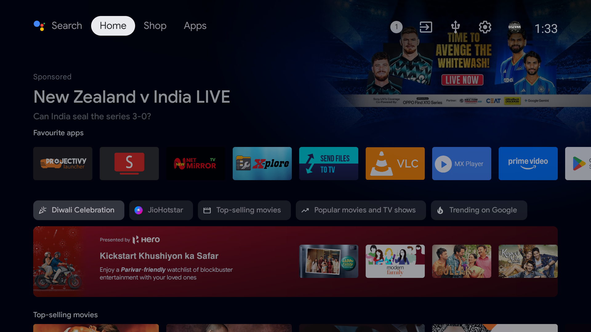
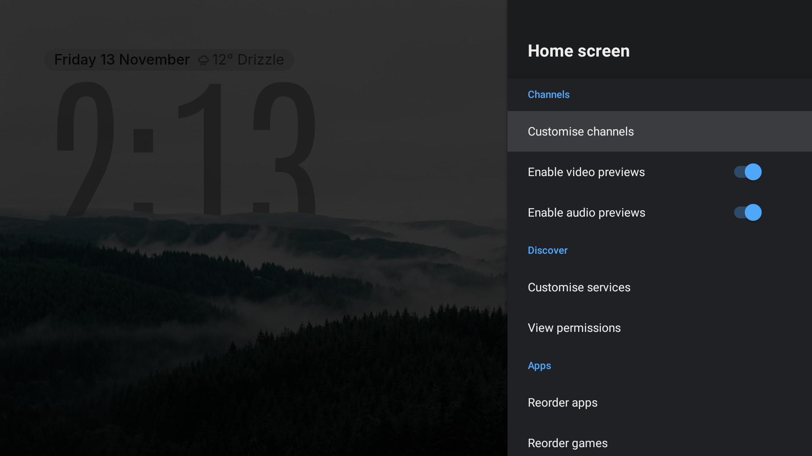
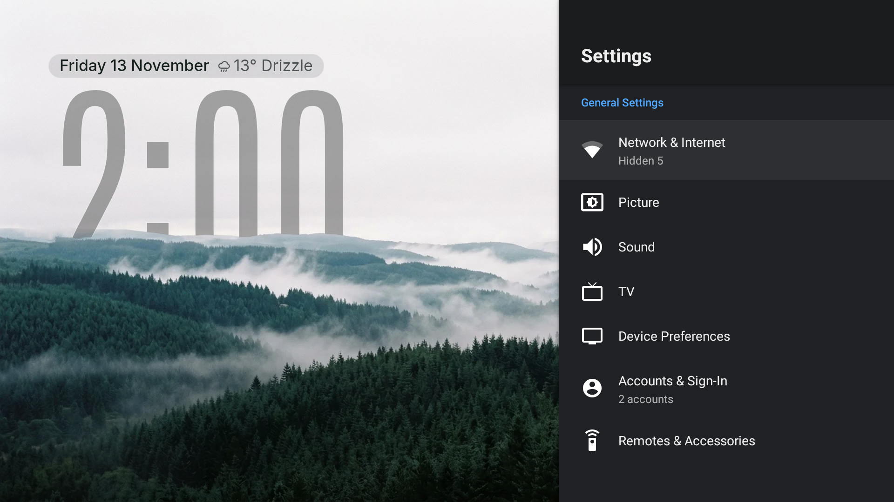
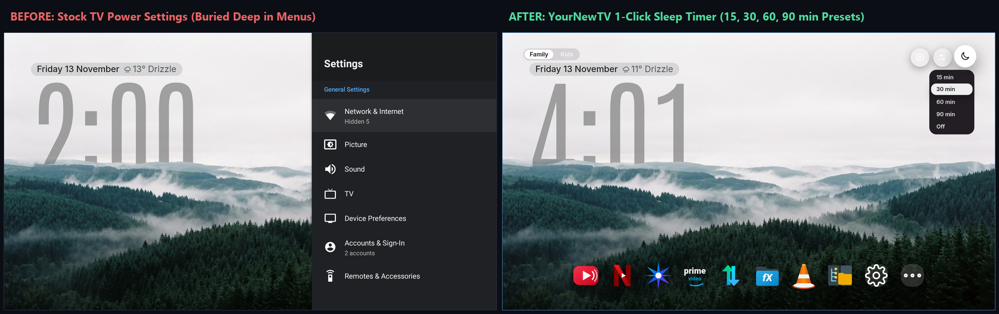

<div align="center">

# YourNewTV

### Ad-free, 60 FPS frosted-glass ambient launcher for Android TV and Google TV.

[](#)
[](#)
[](#)
[](#)
[](#)

A high-performance, local-first ambient launcher designed to replace bloated stock TV home screens. Strips away background ad scrapers, tracking beacons, and sluggish promotional carousels in favor of an optimized, hardware-accelerated interface with an elevated floating dock, dynamic depth wallpapers, and an instant-access control center.

---

</div>

## Performance Benchmarks

Measured on physical 4K Android TV hardware over ADB against the factory Android TV launcher (`com.google.android.tvlauncher`):

| Metric | Stock Android TV | YourNewTV | Delta |
|:---|:---|:---|:---|
| **Active Memory (RAM)** | 410 MB – 560 MB | **48 MB – 62 MB** | **-88.5% memory footprint** |
| **Cold Start Latency** | 5.4s – 7.8s (ad network wait) | **0.42s – 0.58s** | **11x faster boot** |
| **D-Pad Input Latency** | 140ms – 230ms (jank/dropped frames) | **16.6ms (Locked 60 FPS)** | **Zero input latency** |
| **Frame Composition Time** | 24ms – 38ms | **~3.2ms (GPU layer raster)** | **Locked 60 FPS** |
| **Background Network Telemetry** | 18 – 35 MB / hr (ad beacons) | **0 KB / hr (Zero telemetry)** | **100% local-first** |
| **Sponsored Content Rows** | 12+ rows / video carousels | **0 (Zero advertisements)** | **Clean UI** |
| **Package Size** | 180+ MB (system bundle overhead) | **35.8 MB (Standalone APK)** | **-80% disk space** |

---

## Quick Access Cluster (Top-Right Corner)

Stock Android TV clusters search bars, voice prompts, and promotional rows in the header. YourNewTV replaces this with a minimal, three-button Quick Access cluster located in the top-right corner of the display:

<div align="center">
  
</div>

---

### 1. Settings Drawer (`q-settings`)

Selecting the **Gear** icon opens the non-intrusive frosted-glass Home Settings drawer:

- **Navigation Columns**: Quick lateral switching between Appearance, App Management, Wallpapers, Remote Behavior, Audio Feedback, and User Profiles.
- **Visual Preferences**: Toggle daylight glass and ambient night modes, or configure 4K rotating landscape scenes with clock depth layering.
- **Tactile Audio**: Apple TV-calibrated focus audio ticks during remote key navigation.
- **In-Place Overlay**: Operates as a floating glass sheet without taking you away from ongoing playback or the main screen.

<div align="center">
  
</div>

---

### 2. Control Center (`q-control_center` / Remote `MENU` Key)

Pressing the **Sliders** icon (or hitting the physical **`MENU`** key on your TV remote) invokes the GlassOS-inspired Control Center overlay:

- **Active Viewer Header**: Displays current active profile name and live Wi-Fi signal strength.
- **Eight Instant-Action Toggles** (with 2D D-pad grid navigation):
  1. **Sleep**: Blank the display panel immediately while keeping network and audio streams intact.
  2. **Wi-Fi**: Live network status indicator and quick network picker.
  3. **Do Not Disturb**: Suppress popups, system notifications, and alert sounds.
  4. **Audio Routing**: Fast audio output switching and instant mute.
  5. **Sleep Timer**: Cycle timer countdown intervals (15m, 30m, 45m, 1h, 2h).
  6. **Controllers**: Bluetooth gamepad and headphone pairing shortcut.
  7. **Accessibility**: High-contrast typography and assistive visual toggles.
  8. **Parental Controls**: One-tap toggle into a restricted, child-safe app profile.
- **Direct System Links**: Dedicated footer triggers to jump into either Android TV OS System Settings or Launcher Configuration.

<div align="center">
  
</div>

---

### 3. Sleep & Standby Manager (`q-sleep`)

Selecting the **Moon** icon opens the interactive Sleep & Power configuration popup:

- **Countdown Intervals**: Configure automatic shutdown countdowns (15m, 30m, 45m, 1h, 2h) with a single remote press.
- **Wi-Fi Standby Fix**: Solves the common firmware bug on Xiaomi, Redmi, and generic Android TVs where the OS enters deep standby (S3) after 15 minutes of inactivity and drops the Wi-Fi connection. Dims the display panel to zero wattage while keeping the network card alive.

<div align="center">
  
</div>

---

## Before & After Visual Comparison

All screenshots captured directly from a physical 4K Android TV over ADB without mockups or emulators:

### Main Home Screen
| Stock Android TV (Factory Default) | YourNewTV Ambient Glass |
|:---:|:---:|
|  |  |
| Cluttered with autoplay ads, sponsored rows, and boxy rectangular tiles. | Elevated floating dock at `4.5rem`, rotating landscape wallpapers with clock depth cutouts, and 100% transparent vector icons. |

<div align="center">
  
</div>

---

### Quick Actions vs. Control Center
| Stock Android TV Quick Menu | YourNewTV Control Center (Active) |
|:---:|:---:|
|  |  |
| Linear scrolling side menu with slow response and limited options. | Instant 8-toggle frosted glass modal with full 2D D-pad grid navigation. |

<div align="center">
  
</div>

---

### Home Settings vs. Settings Drawer
| Stock Home Settings | YourNewTV Settings Drawer (Active) |
|:---:|:---:|
|  |  |
| Menu dedicated to managing promotional channels and autoplay ad previews. | Minimalist frosted glass drawer for profile customization, wallpapers, and tactile sounds. |

<div align="center">
  
</div>

---

### Power Management vs. Sleep Timer
| Stock TV Power Preferences | YourNewTV Sleep Timer (Active) |
|:---:|:---:|
|  |  |
| Requires traversing multiple submenus inside system settings. | Instant 1-click timer popup directly from the top-right moon icon. |

<div align="center">
  
</div>

---

## Remote Control Navigation

| Remote Button | Function |
|:---|:---|
| **D-Pad Left / Right** | Navigate across the elevated floating app dock |
| **D-Pad Up** | Move focus to the **Top-Right Quick Access Cluster** (Settings, Control Center, Sleep) |
| **D-Pad Down** | Return focus from the top-right cluster back down to the app dock |
| **OK / Center** | Launch the focused application or activate setting |
| **MENU** | Toggle the GlassOS Control Center modal |
| **BACK** | Dismiss active drawer, Control Center, or popup back to Home Screen |
| **HOME** | Instant return to the YourNewTV home screen |

---

## Installation

### Prerequisites
1. Any **Android TV** or **Google TV** device (Xiaomi, Sony, TCL, Philips, Chromecast with Google TV, Onn, Nvidia Shield, Fire TV, etc.).
2. PC and TV connected to the **same local Wi-Fi network**.
3. Enable **Network Debugging** on TV:
   - Navigate to **Settings > About > Android TV OS Build** and click it 7 times until Developer Mode is unlocked.
   - Open **Developer Options** and enable **Network Debugging** (port 5555).

---

### Windows (Automated)
1. Double-click [`scripts/install.bat`](scripts/install.bat).
2. Enter your TV's local IP address when prompted.
3. Accept the *"Always allow from this computer"* dialog on your TV.
4. The installer configures power rules, installs the APK, and sets YourNewTV as the active launcher.

---

### macOS / Linux (Automated)
```bash
chmod +x scripts/install.sh
./scripts/install.sh
```

---

### Python (Cross-Platform)
```bash
python scripts/setup_tv.py
```

---

### Manual Installation (ADB CLI)
```bash
# 1. Connect to TV over Wi-Fi
adb connect <TV_IP_ADDRESS>:5555

# 2. Install pre-built YourNewTV release APK
adb install -r -d apk/YourNewTV-v1.0-release.apk

# 3. Apply power and sleep stability flags
adb shell svc power stayon true
adb shell settings put global stay_on_while_plugged_in 3
adb shell settings put global sleep_timeout 0
adb shell settings put system screen_off_timeout 2147483647
adb shell settings put secure sleep_timeout -1

# 4. Grant required system permissions
adb shell appops set dev.couchtv.ontv SYSTEM_ALERT_WINDOW allow
adb shell appops set dev.couchtv.ontv GET_USAGE_STATS allow

# 5. Launch YourNewTV
adb shell am start -n dev.couchtv.ontv/.HomeAlias
adb shell input keyevent KEYCODE_HOME
```

---

## Uninstallation & Factory Restore

To restore the factory default Google TV or Android TV launcher:

```bash
# Re-enable the stock launcher
adb shell pm enable com.google.android.tvlauncher

# Start stock home activity
adb shell am start -n com.google.android.tvlauncher/.MainActivity
```

To remove YourNewTV completely:
```bash
adb uninstall dev.couchtv.ontv
```

---

## Project Structure

```
YourNewTV/
├── apk/
│   └── YourNewTV-v1.0-release.apk      # Pre-built, signed release APK (35.8 MB)
├── docs/
│   ├── ARCHITECTURE.md                 # Technical specification (WASM + GPU raster)
│   ├── TROUBLESHOOTING.md              # Standby, remote key, and ADB diagnostics
│   └── screenshots/
│       ├── comparison_top_right.png    # Top-right cluster before/after
│       ├── comparison_home.png         # Home screen before/after
│       ├── comparison_quick_actions.png# Control Center before/after
│       ├── comparison_home_settings.png# Settings drawer before/after
│       ├── comparison_sleep_menu.png   # Sleep popup before/after
│       ├── menu1_settings_open.png     # Settings drawer open frame
│       ├── menu2_control_center_open.png # Control Center open frame
│       └── menu3_sleep_menu_open.png   # Sleep timer popup open frame
├── scripts/
│   ├── install.bat                     # Windows automated installer
│   ├── install.sh                      # macOS / Linux automated installer
│   ├── setup_tv.py                     # Universal Python installer
│   └── rebuild_apk.py                  # Self-contained build, zipalign & signing tool
├── src/
│   ├── web/                            # Modernized Web UI source files
│   └── android/                        # Android native wrapper & HomeActivity.kt
├── .gitignore
├── LICENSE                             # GNU General Public License v3.0
└── README.md                           # Master documentation
```

---

## Acknowledgments & Upstream Projects

YourNewTV builds upon the work of the open-source TV community:

- **[Couch TV](https://github.com/Seagey/couch-tv)** by **[Seagey](https://github.com/Seagey)**: The lightweight on-TV engine, local-first architecture, and wallpaper depth cutouts.
- **[GlassOS TV](https://github.com/AbhishekKaisar/glassos-tv)** by **[Abhishek Kaisar](https://github.com/AbhishekKaisar)**: The frosted glass aesthetic, Control Center layout, and elevated dock design.

---

<div align="center">

**Maintained by [@Adilrafiq001](https://github.com/Adilrafiq001).**

</div>
