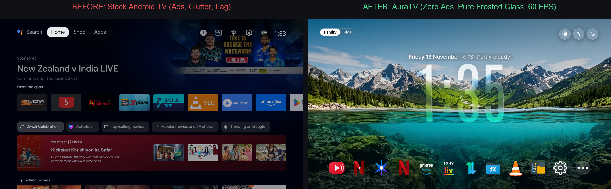
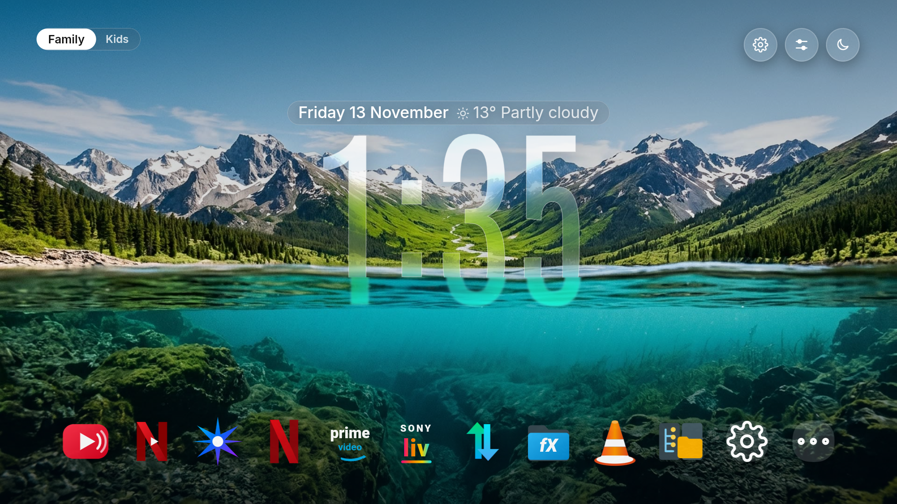
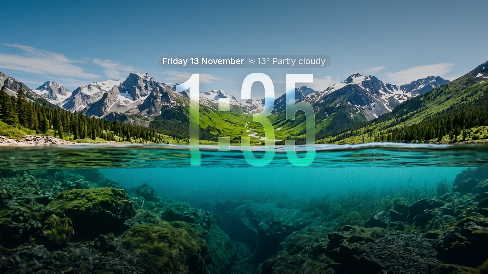

<div align="center">

# 🌌 AuraTV
### The Weightless, Frosted Glass, Ambient Launcher for Android TV & Google TV

[](#)
[](#)
[](#)
[](#)
[](#)

*A breath of fresh air for your living room. Zero sponsored clutter. Zero ad banners. Just pure, weightless frosted glass, elevated floating navigation, ambient depth landscape wallpapers, and instant remote responsiveness.*

---

</div>

## 📸 Before vs. After: The Living Room Upgrade

> **See the difference immediately:** Stock Android TV bombards your screen with autoplay advertisements, sponsored recommendations, and rectangular banner bloat. **AuraTV** replaces all of it with a high-framerate, ad-free ambient glass interface.

<div align="center">



</div>

| ❌ Before: Stock Factory Android TV | ✨ After: AuraTV Ambient Glass |
|:---:|:---:|
|  |  |
| **Cluttered & Monopolized by Ads**<br>Autoplay video banners, sponsored cricket/movie cards, clunky rectangular app tiles, and heavy system lag. | **Minimalist Ambient Frosted Glass**<br>Zero ads, elevated floating dock at `4.5rem`, rotating 4K landscape wallpapers with depth cutouts, and 100% transparent vector icons. |

---

## ✨ Key Features

### 🎛️ GlassOS Quick Control Center
Press the **`MENU`** button on your physical remote at any time to reveal the frosted glass Control Center overlay:
- **8 Instant Toggles**: Sleep, Wi-Fi Status, Do Not Disturb, Audio Mute/Routing, Sleep Timer, Game Controllers, Accessibility, and Parental Locks.
- **2D Discrete D-Pad Navigation**: Full mathematical grid navigation (`Left/Right/Up/Down/Center`) with fluid focus states.
- **Dedicated Quick Links**: Instant one-click jump to TV System Settings and GlassOS Customization.

<div align="center">
  
</div>

### ⚙️ Ambient Settings Drawer & Quick Access Cluster
- **Top-Right Quick Access**: Seamlessly navigate `UP` from the dock to access Settings, Control Center, and Sleep shortcuts without cluttering the wallpaper.
- **Frosted Glass Settings Drawer**: Tailor user profiles, toggle sound effects, and switch wallpaper providers with zero background obstruction.

<div align="center">
  
</div>

### 🎨 Pure Transparent Vector Icons (`clearicon.js`)
- **No Ugly Rectangles**: Replaces standard square app tiles with 100% transparent, vibrant vector silhouettes for SmartTube, Netflix, Prime Video, Hotstar, JioCinema, Sony LIV, Send Files To TV, VLC, X-plore, MX Player, and more.
- **Dynamic Silhouette Extraction**: For third-party apps without built-in SVGs, the custom `clearicon.js` engine removes solid background fills and applies subtle drop-shadows on the fly.

### ⚡ Permanent Stay-Awake & Anti-Sleep Watchdog
- **Eliminates Standby Wi-Fi Cuts**: Solves the notorious issue on Xiaomi / Redmi / Android TVs where the system enters deep sleep after 15 minutes of idle time and severs the Wi-Fi connection.
- **Hardened System Flags**: Bundled with native `FLAG_KEEP_SCREEN_ON` window policies and automated ADB power stabilization.

### 🛡️ 100% Local-First & Zero Paid Infrastructure
- Operates entirely within your local TV network using in-browser WebAssembly and native Android WebView.
- Zero tracking, zero telemetry, zero cloud server dependencies, and zero monthly subscriptions ($0 rule).

---

## 🕹️ Remote Control Quick Reference

| Button | Action |
|:---|:---|
| **D-Pad Left / Right** | Glide smoothly across the elevated floating app dock |
| **D-Pad Up** | Move focus to Top-Right Quick Access Cluster (Settings, Control Center, Sleep) |
| **D-Pad Down** | Return focus from Top-Right Cluster back to the Dock |
| **OK / Center** | Launch highlighted application or toggle setting |
| **MENU** | Open / Close GlassOS Control Center modal |
| **BACK** | Dismiss Control Center or Settings drawer back to Home Screen |
| **HOME** | Return instantly to AuraTV Home Screen |

---

## 🚀 Quick Start: 1-Click Installation

### Prerequisites
1. An **Android TV** or **Google TV** device (Xiaomi, Sony, TCL, Philips, Chromecast with Google TV, Onn, Nvidia Shield, etc.).
2. Computer and TV connected to the **same Wi-Fi network**.
3. **Developer Options** enabled on TV:
   - Go to **Settings > Device Preferences > About** (or **Settings > System > About**).
   - Click **Android TV OS Build** 7 times until you see *"You are now a developer!"*.
   - In **Developer Options**, turn **ON** **Network Debugging** (port 5555).

---

### Option A: Windows 1-Click Installer
1. Connect your PC to the same Wi-Fi as your TV.
2. Double-click `scripts/install.bat`.
3. Enter your TV's IP address when prompted (found in TV Wi-Fi settings).
4. Look at your TV screen and accept the *"Allow USB debugging?"* prompt.
5. Done! AuraTV installs, configures power rules, and launches on your TV.

---

### Option B: macOS / Linux 1-Click Installer
Open Terminal in the repository root and run:
```bash
chmod +x scripts/install.sh
./scripts/install.sh
```

---

### Option C: Universal Python Setup Tool
Works seamlessly across all operating systems:
```bash
python scripts/setup_tv.py
```

---

### Option D: Manual ADB Installation
If you prefer running commands manually:

```bash
# 1. Connect to TV over Wi-Fi
adb connect <TV_IP_ADDRESS>:5555

# 2. Install pre-built AuraTV APK
adb install -r -d apk/AuraTV-v1.0-release.apk

# 3. Apply anti-sleep and Wi-Fi stability settings
adb shell svc power stayon true
adb shell settings put global stay_on_while_plugged_in 3
adb shell settings put global sleep_timeout 0
adb shell settings put system screen_off_timeout 2147483647
adb shell settings put secure sleep_timeout -1

# 4. Grant required TV permissions
adb shell appops set dev.couchtv.ontv SYSTEM_ALERT_WINDOW allow
adb shell appops set dev.couchtv.ontv GET_USAGE_STATS allow

# 5. Launch AuraTV
adb shell am start -n dev.couchtv.ontv/.HomeAlias
adb shell input keyevent KEYCODE_HOME
```

---

## 🔄 How to Undo / Restore Factory Home Screen

You can revert to the stock Google TV / Android TV home screen at any time with zero risk:

```bash
# Re-enable the stock TV launcher
adb shell pm enable com.google.android.tvlauncher

# Switch back to stock launcher
adb shell am start -n com.google.android.tvlauncher/.MainActivity
```

To uninstall AuraTV completely:
```bash
adb uninstall dev.couchtv.ontv
```

---

## 🛠️ Building & Customizing From Source

AuraTV is designed to be easily hackable. The UI is built with standard modern Web technologies (HTML5, CSS3, ES6) packaged into a native Android wrapper.

1. **Modify Frontend Assets**:
   - `src/web/index.html`: DOM structure, Quick Access cluster, Control Center modal.
   - `src/web/app.css`: Frosted glass styling, dock geometry, spring physics.
   - `src/web/app.js`: 2D D-pad navigation engine, profile switcher, watchdog timer.
   - `src/web/clearicon.js`: Icon extraction and SVG rendering dictionary.
2. **Rebuild, Zipalign & Sign APK**:
   ```bash
   python scripts/rebuild_apk.py
   ```
   The rebuilt and signed APK will be output to `apk/AuraTV-v1.0-release.apk`.

---

## 📂 Repository Structure

```
AuraTV/
├── apk/
│   └── AuraTV-v1.0-release.apk         # Pre-built, signed, production-ready APK
├── docs/
│   ├── ARCHITECTURE.md                 # Deep technical architecture breakdown
│   ├── TROUBLESHOOTING.md              # Standby, remote key, and ADB diagnostics
│   └── screenshots/
│       ├── before_after_comparison.png # Side-by-side visual comparison
│       ├── before_stock_android_tv.png # Native stock Android TV home
│       ├── after_aura_tv_home.png      # AuraTV ambient home screen
│       ├── after_aura_tv_control_center.png # Frosted glass Control Center
│       └── after_aura_tv_settings.png  # Frosted glass Settings drawer
├── scripts/
│   ├── install.bat                     # Windows 1-click automated installer
│   ├── install.sh                      # macOS / Linux 1-click installer
│   ├── setup_tv.py                     # Cross-platform Python ADB installer
│   └── rebuild_apk.py                  # Self-contained build, zipalign & signing tool
├── src/
│   ├── web/                            # Modernized Web UI source files
│   └── android/                        # Android native wrapper & HomeActivity.kt
├── .gitignore
├── LICENSE                             # GNU General Public License v3.0
└── README.md                           # Master project documentation
```

---

## 🙏 Credits & Acknowledgments

AuraTV stands on the shoulders of giants in the open-source TV community:

- **[Couch TV](https://github.com/Seagey/couch-tv)** by **[Seagey](https://github.com/Seagey)**: The incredible local-first, low-overhead foundation, on-TV runtime engine, and wallpaper depth architecture.
- **[GlassOS TV](https://github.com/AbhishekKaisar/glassos-tv)** by **[Abhishek Kaisar](https://github.com/AbhishekKaisar)**: The breathtaking frosted glass UI concepts, Control Center layout, and elevated dock aesthetics.
- **Android TV Community**: For testing, feedback, and keeping our living rooms free from ad monopolies.

---

<div align="center">

**Made with ❤️ for clean, ad-free living rooms everywhere.**  
*If you love AuraTV, star the repository and share it with friends!*

</div>
