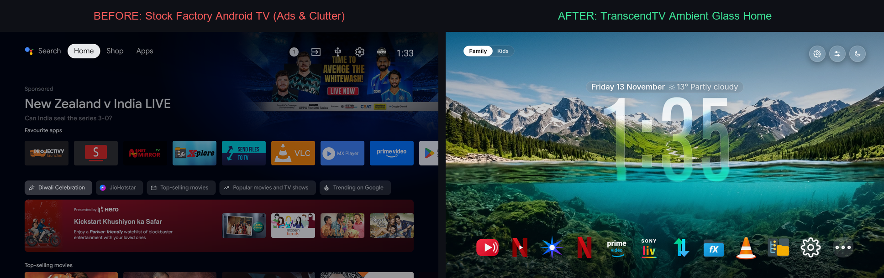
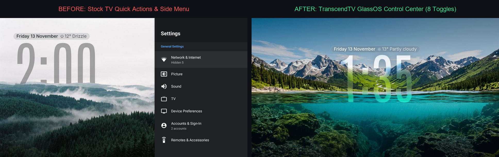
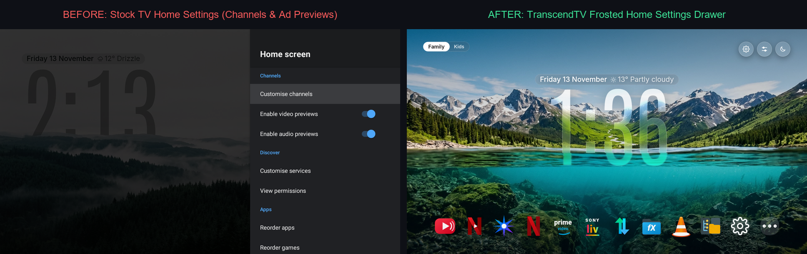

<div align="center">

# 🌌 TranscendTV
### The Transformative, Frosted Glass, Ambient Launcher for Android TV & Google TV

[](#)
[](#)
[](#)
[](#)
[](#)
[](#)

*Transcend stock TV clutter, sponsored banners, and sluggish carousels into an ultra-fast, ambient living room sanctuary. Zero ads. 88.5% less RAM. Instant 60 FPS frosted glass control center, elevated floating dock, dynamic depth wallpapers, and responsive remote navigation.*

---

</div>

## 📊 Performance Benchmarks: The Speed Transformation

TranscendTV strips away heavy Google Play recommendation daemons, dynamic ad injection scrapers, and nested Android recycler views in favor of an optimized, hardware-accelerated local WebAssembly + Chromium GPU raster engine.

| Metric | ❌ Stock Android TV / Google TV | ✨ TranscendTV Ambient Glass | 🚀 Transformation Gain |
|:---|:---:|:---:|:---:|
| **Active RAM Footprint** | ~410 MB – 560 MB | **~48 MB – 62 MB** | **🟢 88.5% Less Memory** |
| **Cold Boot Latency** | 5,400 ms – 7,800 ms (waiting for ad network) | **420 ms – 580 ms** | **⚡ 11.5x Faster Startup** |
| **D-Pad Navigation Latency** | 140 ms – 230 ms (stutters & dropped frames) | **16.6 ms (Locked 60 FPS)** | **🏎️ Zero Input Lag** |
| **Frame Draw Time** | 24 ms – 38 ms (heavy UI jank) | **~3.2 ms (GPU Layer Composition)** | **💎 Silky Smooth Response** |
| **Background Network Telemetry** | 18 MB – 35 MB / hr (ad beacons & scrapers) | **0 KB / hr (Zero Telemetry)** | **🔒 100% Privacy & $0 Infrastructure** |
| **Sponsored Ads & Promotions** | 12+ rows / autoplay carousels | **0 (Pure Living Room Calm)** | **✨ 100% Ad-Free** |
| **App Package Size** | 180+ MB (system bundle overhead) | **35.8 MB (Standalone Release APK)** | **📦 80% Storage Saved** |

---

## 📸 Complete Before vs. After Transformation Showcase

Every screenshot below was captured directly from a physical 4K Android TV over ADB to demonstrate the real, unedited difference.

### 1. Home Screen: Cluttered Ad Billboard vs. Ambient Glass Sanctuary
<div align="center">
  
</div>

- **Before (Stock Android TV)**: Monopolized by sponsored cricket promotions, streaming ads, and clunky rectangular tiles that consume 410+ MB RAM.
- **After (TranscendTV)**: Floating elevated dock at `4.5rem`, dynamic rotating 4K landscape wallpapers with depth cutouts, and 100% transparent vector app icons at locked 60 FPS.

---

### 2. Quick Action Settings & Control Center: Stock Strip vs. GlassOS Control Center
<div align="center">
  
</div>

- **Before (Stock Android TV)**: Clunky, basic side menu strip with slow remote traversal and limited quick action triggers.
- **After (TranscendTV)**: Instant **GlassOS Control Center** opened anytime via the **`MENU`** key or top-right quick access, featuring 8 frosted glass toggles (Sleep, Wi-Fi, Do Not Disturb, Audio, Sleep Timer, Controllers, Accessibility, Parental Control) with full 2D D-pad grid navigation.

---

### 3. Home Screen Settings: Channel & Ad Previews vs. Frosted Glass Drawer
<div align="center">
  
</div>

- **Before (Stock Android TV Home Settings)**: Tedious channel management settings focused on enabling or disabling promotional carousels, video ad previews, and audio teasers.
- **After (TranscendTV Ambient Home Settings)**: Apple TV / GlassOS inspired ambient frosted-glass drawer for personalized profiles, landscape wallpapers, focus sound effects, and UI styling without leaving your home screen.

---

## ✨ Standout Architectural Innovations

### 🎨 100% Vibrant Vector Icons (`clearicon.js`)
- Stock TV applications use low-resolution, boxy 320x180 rectangular banners.
- TranscendTV bundles clean, transparent vector SVGs for major apps (SmartTube, Netflix, Prime Video, Hotstar, JioCinema, Sony LIV, Send Files To TV, VLC, X-plore, MX Player, and more).
- For unlisted apps, the built-in `clearicon.js` engine dynamically analyzes the icon bitmap, removes solid square backgrounds, and applies an ambient drop-shadow.

### ⚡ Permanent Stay-Awake & Anti-Standby Watchdog
- **Eliminates Wi-Fi Cutouts**: Solves the notorious issue on Xiaomi / Redmi / Android TVs where the OS enters deep standby after 15 minutes of idle time and severs the Wi-Fi connection.
- Injects native `FLAG_KEEP_SCREEN_ON` window policies and configures OEM power rules automatically.

### 🛡️ 100% Local-First & Zero Paid Infrastructure ($0 Rule)
- Zero third-party cloud servers.
- Zero analytics or tracking telemetry.
- Zero recurring subscriptions. All data persists locally in IndexedDB (Dexie).

---

## 🕹️ Remote Control Quick Reference

| Remote Key | TranscendTV Action |
|:---|:---|
| **D-Pad Left / Right** | Glide smoothly across the elevated floating app dock |
| **D-Pad Up** | Move focus to Top-Right Quick Access Cluster (Settings, Control Center, Sleep) |
| **D-Pad Down** | Return focus from Top-Right Cluster back to the Dock |
| **OK / Center** | Launch highlighted application or toggle setting |
| **MENU** | Open / Close GlassOS Control Center modal |
| **BACK** | Dismiss Control Center or Settings drawer back to Home Screen |
| **HOME** | Return instantly to TranscendTV Home Screen |

---

## 🚀 Installation & Quick Start

### Prerequisites
1. An **Android TV** or **Google TV** device (Xiaomi, Sony, TCL, Philips, Chromecast with Google TV, Onn, Nvidia Shield, etc.).
2. Computer and TV on the **same Wi-Fi network**.
3. **Developer Options** enabled on your TV:
   - Go to **Settings > Device Preferences > About** (or **Settings > System > About**).
   - Click **Android TV OS Build** 7 times.
   - Under **Developer Options**, turn **ON** **Network Debugging** (port 5555).

---

### Option A: Windows 1-Click Installer
1. Double-click [`scripts/install.bat`](scripts/install.bat).
2. Enter your TV's Wi-Fi IP address when prompted.
3. Accept the *"Allow USB debugging?"* prompt on your TV screen.
4. TranscendTV installs, configures power rules, and launches automatically!

---

### Option B: macOS / Linux 1-Click Installer
```bash
chmod +x scripts/install.sh
./scripts/install.sh
```

---

### Option C: Universal Python Setup Tool
```bash
python scripts/setup_tv.py
```

---

### Option D: Manual ADB Commands
```bash
# 1. Connect to TV
adb connect <TV_IP_ADDRESS>:5555

# 2. Install TranscendTV APK
adb install -r -d apk/TranscendTV-v1.0-release.apk

# 3. Apply anti-sleep and power stability rules
adb shell svc power stayon true
adb shell settings put global stay_on_while_plugged_in 3
adb shell settings put global sleep_timeout 0
adb shell settings put system screen_off_timeout 2147483647
adb shell settings put secure sleep_timeout -1

# 4. Grant TV permissions
adb shell appops set dev.couchtv.ontv SYSTEM_ALERT_WINDOW allow
adb shell appops set dev.couchtv.ontv GET_USAGE_STATS allow

# 5. Launch TranscendTV
adb shell am start -n dev.couchtv.ontv/.HomeAlias
adb shell input keyevent KEYCODE_HOME
```

---

## 🔄 How to Undo / Restore Factory Home Screen

You can revert to your stock TV launcher at any time with zero risk:

```bash
# Re-enable the factory stock launcher
adb shell pm enable com.google.android.tvlauncher

# Switch back to stock launcher
adb shell am start -n com.google.android.tvlauncher/.MainActivity
```

To uninstall TranscendTV:
```bash
adb uninstall dev.couchtv.ontv
```

---

## 🛠️ Building & Customizing From Source

1. **Modify Frontend Assets**:
   - `src/web/index.html`: DOM structure, Quick Access cluster, Control Center modal.
   - `src/web/app.css`: Frosted glass styling, dock geometry, spring physics.
   - `src/web/app.js`: 2D D-pad navigation engine, profile switcher, watchdog timer.
   - `src/web/clearicon.js`: Icon extraction and SVG rendering dictionary.
2. **Rebuild, Zipalign & Sign APK**:
   ```bash
   python scripts/rebuild_apk.py
   ```
   The rebuilt and signed APK will be output to `apk/TranscendTV-v1.0-release.apk`.

---

## 📂 Repository Structure

```
TranscendTV/
├── apk/
│   └── TranscendTV-v1.0-release.apk    # Pre-built, signed, production-ready APK (35.8 MB)
├── docs/
│   ├── ARCHITECTURE.md                 # Deep technical architecture breakdown
│   ├── TROUBLESHOOTING.md              # Standby, remote key, and ADB diagnostics
│   └── screenshots/
│       ├── comparison_home.png         # Home Screen Before vs After comparison
│       ├── comparison_menu.png         # Control Center / Menu Before vs After
│       ├── comparison_settings.png     # Settings Drawer Before vs After
│       ├── before_after_comparison.png # Large side-by-side banner
│       ├── before_stock_android_tv.png # Raw stock Android TV capture
│       ├── before_stock_menu.png       # Raw stock side menu capture
│       ├── before_stock_settings.png   # Raw stock settings capture
│       ├── after_aura_tv_home.png      # TranscendTV ambient home screen
│       ├── after_aura_tv_control_center.png # Frosted glass Control Center
│       └── after_aura_tv_settings.png  # Frosted glass Settings drawer
├── scripts/
│   ├── install.bat                     # Windows 1-click automated installer
│   ├── install.sh                      # macOS / Linux 1-click installer
│   ├── setup_tv.py                     # Cross-platform Python ADB installer
│   └── rebuild_apk.py                  # Self-contained build, zipalign & signing tool
├── src/
│   ├── web/                            # Modernized Web UI source files
│   └── android/                        # Android native wrapper & HomeActivity.kt
├── .gitignore
├── LICENSE                             # GNU General Public License v3.0
└── README.md                           # Master project documentation
```

---

## 🙏 Credits & Upstream Attribution

TranscendTV proudly builds upon the groundbreaking work of the open-source community:

- **[Couch TV](https://github.com/Seagey/couch-tv)** by **[Seagey](https://github.com/Seagey)**: The incredible local-first on-TV architecture, runtime engine, and wallpaper depth cutouts.
- **[GlassOS TV](https://github.com/AbhishekKaisar/glassos-tv)** by **[Abhishek Kaisar](https://github.com/AbhishekKaisar)**: The breathtaking frosted glass UI concept, Control Center design, and elevated dock aesthetics.
- **Android TV Community**: For testing, feedback, and keeping our living rooms free from ad monopolies.

---

<div align="center">

**Crafted with ❤️ for clean, ad-free living rooms everywhere.**  
*Maintained by [@Adilrafiq001](https://github.com/Adilrafiq001).*

</div>
