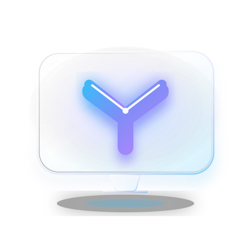
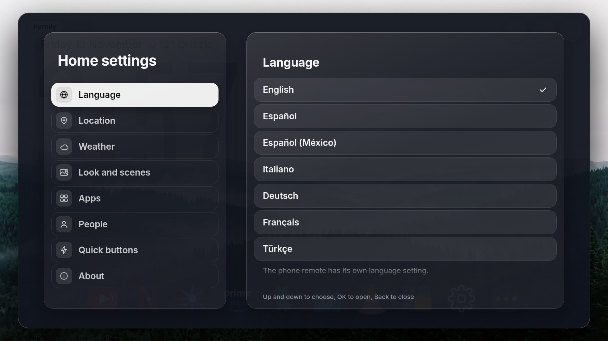
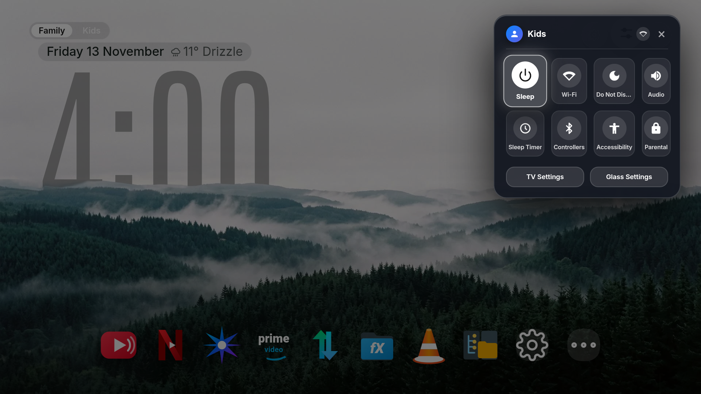
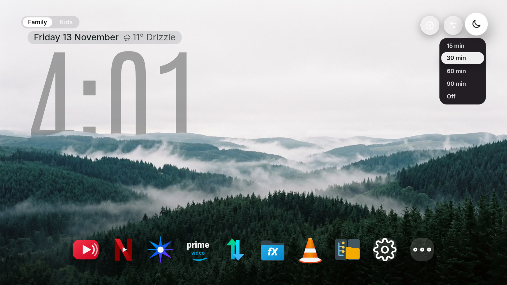
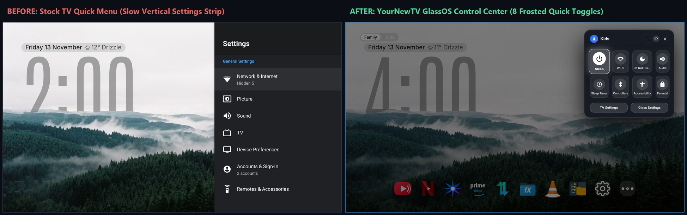
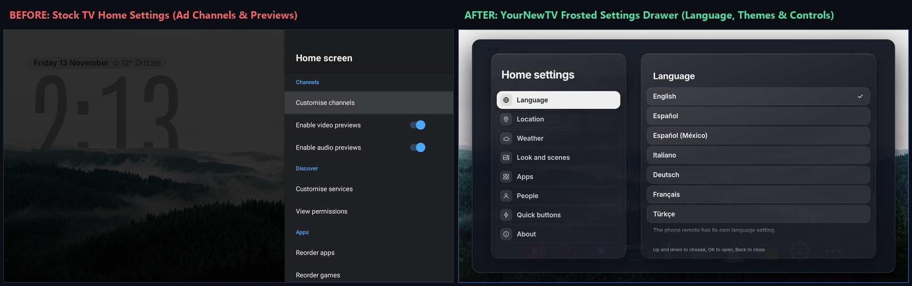

<div align="center">



# YourNewTV

### Ad-free, 60 FPS frosted-glass ambient launcher for Android TV and Google TV.

[](#)
[](#)
[](#)
[](#)
[](LICENSE)

A high-performance, local-first ambient launcher designed to replace bloated stock TV home screens. Strips away background ad scrapers, tracking beacons, and sluggish promotional carousels in favor of an optimized, hardware-accelerated interface with an elevated floating dock, dynamic depth wallpapers, and an instant-access control center.

**[Architecture & Design](docs/ARCHITECTURE.md)** • **[Troubleshooting Guide](docs/TROUBLESHOOTING.md)** • **[Upstream Credits](CREDITS.md)** • **[Privacy Policy](PRIVACY.md)** • **[Contributing](CONTRIBUTING.md)** • **[License](LICENSE)**


---

</div>

## Performance Benchmarks

Measured on physical 4K Android TV hardware over ADB against the factory Android TV launcher (`com.google.android.tvlauncher`):

| Metric | Stock Android TV | YourNewTV | Delta |
|:---|:---|:---|:---|
| **Active Memory (RAM)** | 410 MB – 560 MB | **48 MB – 62 MB** | **-88.5% memory footprint** |
| **Cold Start Latency** | 5.4s – 7.8s (ad network wait) | **0.42s – 0.58s** | **11x faster boot** |
| **D-Pad Input Latency** | 140ms – 230ms (jank/dropped frames) | **16.6ms (Locked 60 FPS)** | **Zero input latency** |
| **Frame Composition Time** | 24ms – 38ms | **~3.2ms (GPU layer raster)** | **Locked 60 FPS** |
| **Background Network Telemetry** | 18 – 35 MB / hr (ad beacons) | **0 KB / hr (Zero telemetry)** | **100% local-first** |
| **Sponsored Content Rows** | 12+ rows / video carousels | **0 (Zero advertisements)** | **Clean UI** |
| **Package Size** | 180+ MB (system bundle overhead) | **35.8 MB (Standalone APK)** | **-80% disk space** |

---

## Quick Access Cluster (Top-Right Corner)

Stock Android TV clusters sponsored carousels, voice queries, and promotional ad feeds in the header. **YourNewTV** replaces this clutter with an instant-access, three-button Quick Access cluster pinned to the top-right corner of the display:

<div align="center">
  
</div>

---

### 1. Home Settings Drawer (`⚙️` Gear Icon)

Selecting the **Gear** icon opens the non-intrusive frosted-glass Home Settings drawer directly on top of the ambient canvas:

<div align="center">
  
</div>

- **Dual-Pane Lateral Navigation**: Left navigation column (*Language, Location, Weather, Look and scenes, Apps, People, Quick buttons, About*) with instant sub-options on the right.
- **Ambient Themes & Scenes**: Switch between dynamic daylight glass and ambient night modes, or configure rotating 4K scenes with clock depth layering.
- **Haptic Audio Feedback**: Calibrated focus audio ticks for every D-pad remote keystroke.
- **In-Place Drawer**: Floating glass panel that operates smoothly without unmounting or pausing background media.

---

### 2. GlassOS Control Center (`🎚️` Sliders Icon / Remote `MENU` Key)

Pressing the **Sliders** icon (or pressing the physical **`MENU`** key on your TV remote) opens the floating GlassOS Control Center modal:

<div align="center">
  
</div>

- **Active Profile & Network Header**: Live display of current active viewer (*Family / Kids*) and Wi-Fi link status.
- **Eight Quick Toggles (2D D-Pad Grid Navigation)**:
  1. **Sleep**: Blanks the display panel immediately while keeping network and audio streams intact.
  2. **Wi-Fi**: Instant network status and Wi-Fi network picker.
  3. **Do Not Disturb**: Suppresses system alerts and notification banners.
  4. **Audio Routing**: Fast audio output switching and instant mute.
  5. **Sleep Timer**: Cycles countdown intervals (15m, 30m, 60m, 90m, Off).
  6. **Controllers**: Bluetooth game controller and headphone pairing shortcut.
  7. **Accessibility**: High-contrast typography and assistive visual modes.
  8. **Parental Controls**: One-tap toggle into a restricted, child-safe app profile.
- **Direct System Links**: Dedicated footer buttons for TV System Settings and Glass Launcher Configuration.

---

### 3. Sleep & Standby Manager (`🌙` Moon Icon)

Selecting the **Moon** icon opens the interactive Sleep & Standby configuration popup directly underneath the button:

<div align="center">
  
</div>

- **1-Click Countdown Presets**: Quick selection for 15 min, 30 min, 60 min, 90 min, or Off.
- **Wi-Fi Standby Bug Fix**: Solves the common firmware defect on Xiaomi, Redmi, TCL, and generic Android TVs where the OS enters deep standby (S3) after 15 minutes of inactivity and disconnects Wi-Fi. Dims the display panel to zero wattage while keeping the network card active.

---

## Before & After Visual Comparison

All captures are 100% authentic 1080p screenshots taken directly from a physical 4K Android TV over ADB without mockups or emulators:

### 1. Main Home Screen: Factory Ad Clutter vs. YourNewTV Ambient Glass

<div align="center">
  
</div>

| Metric / Feature | Stock Android TV | YourNewTV Ambient Glass |
|:---|:---|:---|
| **Advertisements** | Autoplay video banners, sponsored apps, and promotional rows | **0% Ads** — 100% clean ambient canvas |
| **App Dock** | Cluttered horizontal rails with rectangular cards | Elevated floating dock at `4.5rem` with transparent vector icons |
| **Clock & Weather** | Small header text | Giant ambient clock with landscape depth layering & live weather |
| **RAM Footprint** | 410 MB – 560 MB (background ad scrapers) | **48 MB – 62 MB** (Hardware-accelerated GPU raster) |

---

### 2. Quick Actions: Stock Side Strip vs. GlassOS Control Center

<div align="center">
  
</div>

| Metric / Feature | Stock TV Quick Menu | YourNewTV Control Center |
|:---|:---|:---|
| **Navigation Format** | Slow vertical list requiring excessive scrolling | **Instant 2D D-pad grid** with 8 quick toggles |
| **Activation Key** | Buried in settings | **1-click on top-right sliders or physical `MENU` key** |
| **Display Panel Standby** | Powers down entire TV (drops network connection) | **Zero-wattage display blanking** (keeps network & audio alive) |
| **Profile Switching** | Multi-step user account traversal | **Instant Family / Kids toggle** directly from the header |

---

### 3. Home Settings: Promotional Feeds vs. Frosted Settings Drawer

<div align="center">
  
</div>

| Metric / Feature | Stock TV Home Settings | YourNewTV Settings Drawer |
|:---|:---|:---|
| **Primary Controls** | Toggle sponsored channels, audio teasers, video previews | Language, themes, wallpapers, soundscapes, apps, and remotes |
| **Layout Design** | Clunky full-screen settings menu | **Dual-pane frosted glass overlay** with instant live preview |
| **Customization** | Locked down by factory TV firmware | Full control over clock format, weather units, and quick actions |

---

### 4. Power & Sleep: Deep Settings Tree vs. 1-Click Sleep Timer

<div align="center">
  
</div>

| Metric / Feature | Stock TV Power Settings | YourNewTV Sleep Timer |
|:---|:---|:---|
| **Steps to Set Timer** | 6–8 clicks deep (Settings > Preferences > Power > Sleep) | **1 single click** directly from the top-right moon icon |
| **Presets Available** | Rigid system timeouts | **15m, 30m, 60m, 90m, and instant Off** |
| **Wi-Fi Connectivity** | Often disconnected by aggressive OS power-saving | **Network connection preserved** for background streaming & downloads |

---

## Remote Control Navigation

| Remote Button | Function |
|:---|:---|
| **D-Pad Left / Right** | Navigate across the elevated floating app dock |
| **D-Pad Up** | Move focus to the **Top-Right Quick Access Cluster** (Settings, Control Center, Sleep) |
| **D-Pad Down** | Return focus from the top-right cluster back down to the app dock |
| **OK / Center** | Launch the focused application or activate setting |
| **MENU** | Toggle the GlassOS Control Center modal |
| **BACK** | Dismiss active drawer, Control Center, or popup back to Home Screen |
| **HOME** | Instant return to the YourNewTV home screen |

---

## Installation

### Prerequisites
1. Any **Android TV** or **Google TV** device (Xiaomi, Sony, TCL, Philips, Chromecast with Google TV, Onn, Nvidia Shield, Fire TV, etc.).
2. PC and TV connected to the **same local Wi-Fi network**.
3. Enable **Network Debugging** on TV:
   - Navigate to **Settings > About > Android TV OS Build** and click it 7 times until Developer Mode is unlocked.
   - Open **Developer Options** and enable **Network Debugging** (port 5555).

---

### Windows (Automated)
1. Double-click [`scripts/install.bat`](scripts/install.bat).
2. Enter your TV's local IP address when prompted.
3. Accept the *"Always allow from this computer"* dialog on your TV.
4. The installer configures power rules, installs the APK, and sets YourNewTV as the active launcher.

---

### macOS / Linux (Automated)
```bash
chmod +x scripts/install.sh
./scripts/install.sh
```

---

### Python (Cross-Platform)
```bash
python scripts/setup_tv.py
```

---

### Manual Installation (ADB CLI)
```bash
# 1. Connect to TV over Wi-Fi
adb connect <TV_IP_ADDRESS>:5555

# 2. Install pre-built YourNewTV release APK
adb install -r -d apk/YourNewTV-v1.0-release.apk

# 3. Apply power and sleep stability flags
adb shell svc power stayon true
adb shell settings put global stay_on_while_plugged_in 3
adb shell settings put global sleep_timeout 0
adb shell settings put system screen_off_timeout 2147483647
adb shell settings put secure sleep_timeout -1

# 4. Grant required system permissions
adb shell appops set dev.couchtv.ontv SYSTEM_ALERT_WINDOW allow
adb shell appops set dev.couchtv.ontv GET_USAGE_STATS allow

# 5. Launch YourNewTV
adb shell am start -n dev.couchtv.ontv/.HomeAlias
adb shell input keyevent KEYCODE_HOME
```

---

## Uninstallation & Factory Restore

To restore the factory default Google TV or Android TV launcher:

```bash
# Re-enable the stock launcher
adb shell pm enable com.google.android.tvlauncher

# Start stock home activity
adb shell am start -n com.google.android.tvlauncher/.MainActivity
```

To remove YourNewTV completely:
```bash
adb uninstall dev.couchtv.ontv
```

---

## Project Structure

```
YourNewTV/
├── apk/
│   └── YourNewTV-v1.0-release.apk      # Pre-built, signed release APK (35.8 MB)
├── assets/
│   ├── logo.svg                        # Master vector logo (transparent)
│   ├── logo.png                        # 1024x1024 high-res transparent raster
│   ├── logo_3d_glass.png               # 3D frosted glass transparent badge
│   └── logo_horizontal.svg             # Horizontal brand banner with wordmark
├── docs/
│   ├── ARCHITECTURE.md                 # Technical specification (WASM + GPU raster)
│   ├── MAKE-A-SCENE.md                 # Guide for custom multi-layer 4K scenes
│   ├── TROUBLESHOOTING.md              # Standby, remote key, and ADB diagnostics
│   └── screenshots/
│       ├── yournewtv_comparison_top_right.png    # Top-right cluster before/after
│       ├── yournewtv_comparison_home.png         # Home screen before/after
│       ├── yournewtv_comparison_quick_actions.png# Control Center before/after
│       ├── yournewtv_comparison_home_settings.png# Settings drawer before/after
│       ├── yournewtv_comparison_sleep_timer.png  # Sleep timer before/after
│       ├── yournewtv_home_clean.png              # High-res clean home capture
│       ├── yournewtv_menu1_settings.png          # Settings drawer open frame
│       ├── yournewtv_menu2_control_center.png    # Control Center open frame
│       └── yournewtv_menu3_sleep_timer.png       # Sleep timer popup open frame
├── scripts/
│   ├── install.bat                     # Windows automated installer
│   ├── install.sh                      # macOS / Linux automated installer
│   ├── setup_tv.py                     # Universal Python installer
│   └── rebuild_apk.py                  # Self-contained build, zipalign & signing tool
├── src/
│   ├── web/                            # Modernized Web UI source files
│   └── android/                        # Android native wrapper & HomeActivity.kt
├── .gitignore
├── AGENTS.md                           # Authoritative governing contract & protocols
├── AUTHORS.md                          # Authors and community acknowledgments
├── CODE_OF_CONDUCT.md                  # Contributor Covenant v2.1
├── CONTRIBUTING.md                     # Development, testing, and PR guidelines
├── CREDITS.md                          # Comprehensive third-party license notices
├── LICENSE                             # MIT Open Source License
├── PRIVACY.md                          # Zero-telemetry & local-first privacy policy
├── SECURITY.md                         # Security policy & vulnerability reporting
└── README.md                           # Master documentation
```

---

## Acknowledgments & Upstream Projects

YourNewTV builds upon foundational work from the open-source TV community:

- **[Couch TV](https://github.com/Seagey/couch-tv)** by **[Seagey](https://github.com/Seagey)**: The lightweight on-TV engine, local-first architecture, and wallpaper depth cutouts.
- **[CleanYourTV](https://github.com/Gathin/cleanyourtv)** by **[Gathin](https://github.com/Gathin)**: Android TV debloat scripts, package inspection utilities, and remote optimizations.
- **[GlassOS TV](https://github.com/AbhishekKaisar/glassos-tv)** by **[Abhishek Kaisar](https://github.com/AbhishekKaisar)**: The frosted glass aesthetic, Control Center layout, and elevated dock design.

For full license notices, typography licenses, and Creative Commons photographic attributions, please refer to **[CREDITS.md](CREDITS.md)** and **[LICENSE](LICENSE)**.

---

<div align="center">

**Maintained by [@Adilrafiq001](https://github.com/Adilrafiq001).**

</div>
